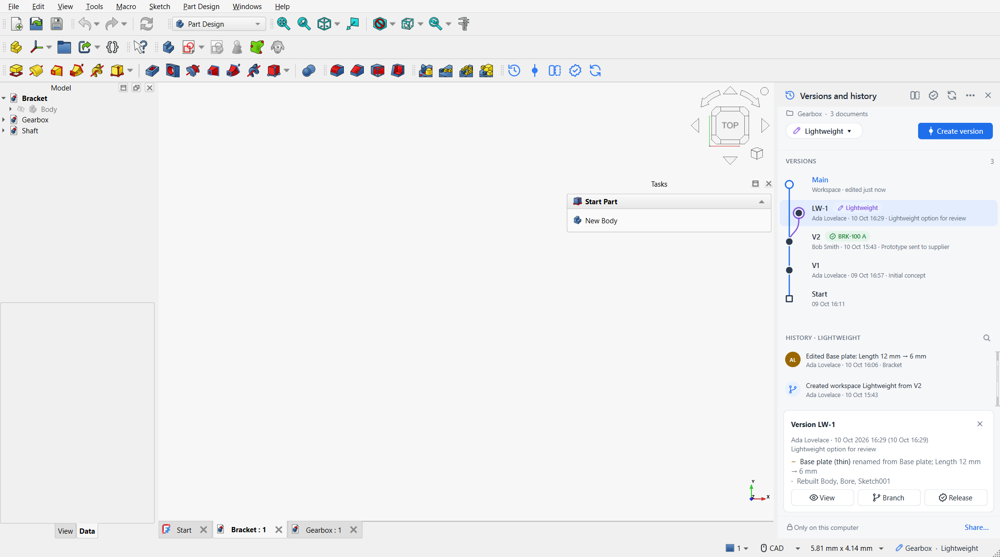
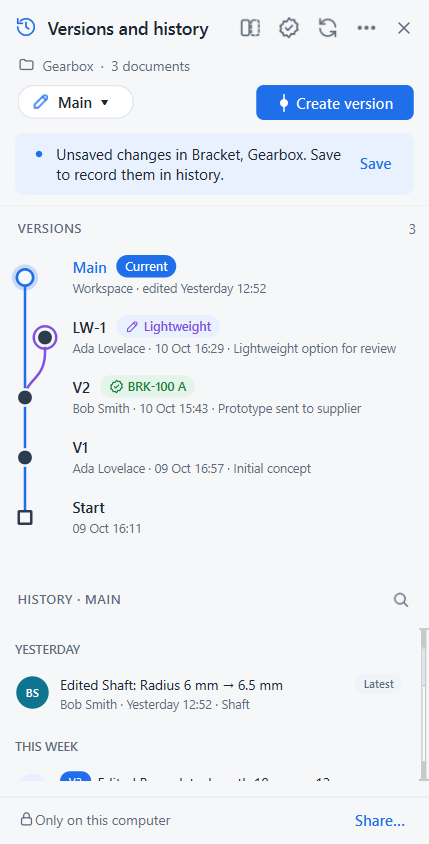
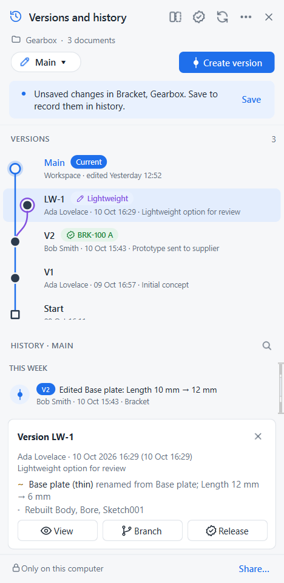
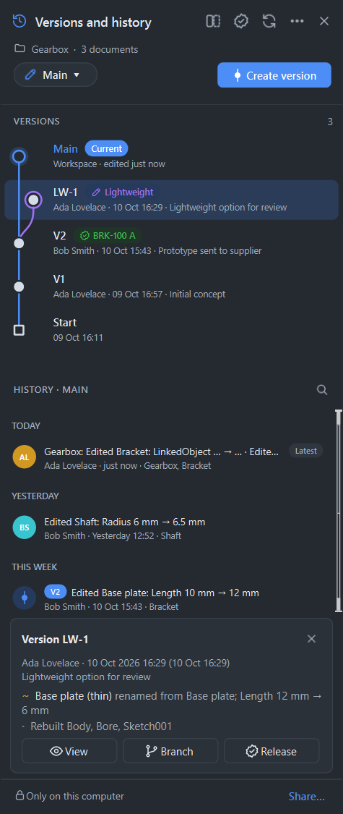
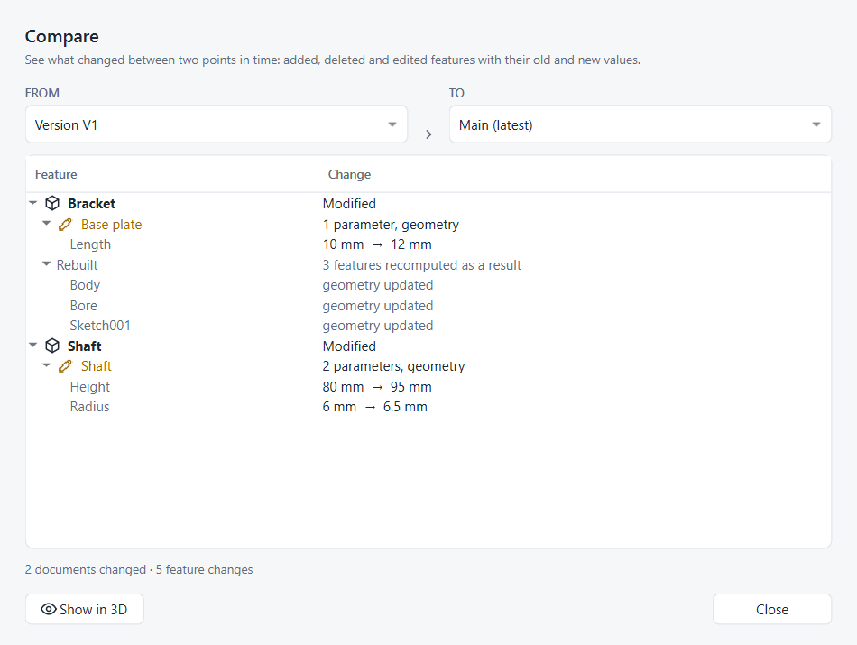
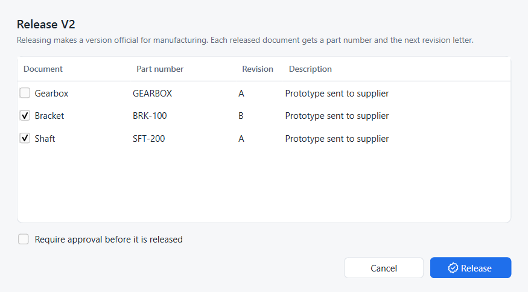
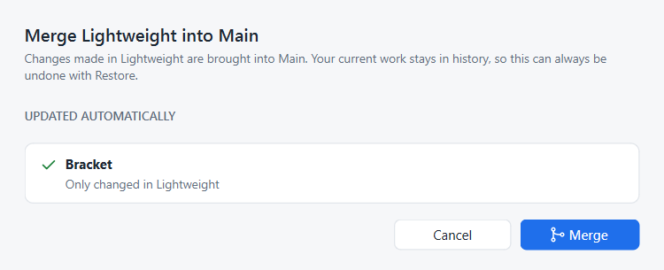

# Strata — versions, workspaces and releases for FreeCAD

Strata is a FreeCAD 1.x add-on that gives FreeCAD the version management engineers know from Onshape: every save is recorded automatically, milestones become named **versions**, ideas are explored in **workspaces**, and any point in time can be viewed, compared or restored. Finished versions are **released** under a part number and revision. Git does the storage underneath, and engineers never see it.

It implements the proposal in the FreeCAD forum thread [Proposal for Integrated Version Control in FreeCAD for PLM/PDM Functionality](https://forum.freecad.org/viewtopic.php?t=89249), adjusted for the objections raised there (see *Design decisions*).



## What engineers see

| Onshape term | Strata | Underneath |
|---|---|---|
| History | Every save, described in plain language: *Edited Base plate: Length 10 mm → 12 mm* | commit |
| Version | Named, permanent snapshot of the whole project (*V2 – Prototype sent to supplier*) | annotated tag |
| Workspace | Separate line of work; Main is untouched until you merge | branch |
| Branch to create workspace | Right-click any version or history entry | branch from commit |
| Restore | Brings the workspace back to any point **as a new history entry**, so nothing is lost | new commit with an old tree |
| Compare | Added / deleted / edited features with old → new values, plus a 3D before/after overlay with volume change | semantic diff of `Document.xml` |
| Merge | Documents changed on one side are taken over; documents changed on both sides offer *Keep mine / Take theirs / Keep both* | three-way merge per document |
| Release | Part number + next revision letter (A, B, … skipping I O Q S X Z per ASME Y14.35), optional approval, Obsolete | tags under `release/`, `pending/`, `rejected/`, `obsolete/` |
| Share / Sync | A network folder, synced drive or Git server; works offline, sync when reachable | fetch / push |

The panel follows FreeCAD's light or dark theme. A status-bar pill shows *project · workspace*, and the toolbar holds *Versions and history* and *Create version*. Both are available in every workbench.

| Panel | Version card | Dark theme |
|---|---|---|
|  |  |  |

| Compare | Release | Merge |
|---|---|---|
|  |  |  |

## Install

Requirements: FreeCAD 1.0 or newer and [Git](https://git-scm.com) on the PATH (or in the default Git for Windows / GitHub Desktop location).

Copy or link this folder into FreeCAD's user `Mod` folder and restart FreeCAD:

- FreeCAD 1.1: `%APPDATA%\FreeCAD\v1-1\Mod\Strata` (Windows), `~/.local/share/FreeCAD/v1-1/Mod/Strata` (Linux)
- FreeCAD 1.0: `%APPDATA%\FreeCAD\Mod\Strata`

## Use

1. Save your documents into a project folder, open the **Versions and history** panel and click **Turn on version control**. All `.FCStd` files in that folder and its sub-folders are versioned together, so an assembly and its parts always match.
2. Work and save as usual. Every save appears in History.
3. **Create version** for milestones. Use the workspace pill (*Main ▾*) to create, switch and merge workspaces.
4. Hover a history entry to **view** it (read-only copy) or **restore** it. Right-click versions and entries for everything else.
5. **Share…** in the panel footer sets a shared location; **Sync** exchanges work with colleagues, who use *Open a shared project…*.

## Design decisions

- **History lives beside the files, not inside them.** The forum post proposed a Git repository inside each `.FCStd`. Tested on FreeCAD 1.1.4: FreeCAD rewrites the whole archive on every save and **drops entries it does not know**, so an embedded repository would be erased by the next save without a core change, as onekk predicted in the thread. Strata keeps a hidden bare repository in `<project>/.strata/`.
- **Projects, not single files.** Versions cover every document in the project folder, which handles linked documents and assemblies (onekk's second objection). The engine test checks that a restored assembly's link resolves to the restored part.
- **Text by default.** Only textual archive entries are shared through Git: `Document.xml`, `GuiDocument.xml`, ASCII BREP, element maps. That includes BREP geometry, so imported non-parametric solids (the STEP case raised in the thread) restore exactly without a recompute. Binary entries (thumbnails, colour tables, binary BREP) are kept in a local content-addressed store, so restores on the same computer are exact. *Project settings* can share them too.
- **No jargon.** Engineers never type a commit message. Entries are written from a semantic diff of the FreeCAD document that leaves out FreeCAD bookkeeping (origin features, attacher internals, floating-point noise, link timestamps).
- **Pluggable later.** The engine (`strata/project.py`) has no FreeCAD or Qt dependency, which is the integration API drmacro asked for. A Teamcenter/Windchill/Aras connector would implement the same operations.
- **Fast on Windows.** Objects and refs are written and read in Python; Git is only started for init, fetch, push and packed objects. A save-triggered record takes ~80–90 ms on the test laptop.

## Layout

```
InitGui.py            starts Strata in the FreeCAD GUI (not a workbench)
strata/gitcore.py     dependency-free Git plumbing (loose objects, refs, history walks)
strata/fcstd.py       explode / rebuild .FCStd archives, local binary store
strata/docdiff.py     semantic Document.xml diff and plain-language summaries
strata/project.py     the model: record, versions, workspaces, restore, merge, releases, sync
strata/fc.py          FreeCAD glue: save observer, reload, previews, 3D compare overlay
strata/ui/            theme + icons, version graph, history list, panel, dialogs
tests/                core tests, FreeCAD engine test, GUI screenshot test
```

## Tests

```bash
python tests/test_core.py
```

```bash
freecadcmd tests/fc_engine_test.py
```

`tests/run_gui_hidden.py <demo-folder> <out-folder>` builds nothing itself. First run `freecadcmd tests/make_demo.py <folder>` for a demo project, then it drives the real GUI on a hidden Windows desktop under a memory ceiling and saves the screenshots above.

## Not done yet

- Object-level merge inside one document (today the choice is per document).
- File locking / check-out for teams that want it (m.no's request in the thread).
- Release packages (STEP/PDF export on release), role-based approvers, BOM view.
- Connectors to commercial PLM systems through the engine API.
- Fonts and other machine-dependent resources are not captured (onekk's point; out of scope for document versioning).

License: LGPL-2.1-or-later.
