<p align="center">
  
</p>

<h1 align="center">Strata</h1>

<p align="center">
  <b>Versions, workspaces, history and releases for FreeCAD, with an Onshape-style interface.</b><br>
  Every save is recorded. Milestones become versions. Ideas live in workspaces. Nobody has to learn Git.
</p>

<p align="center">
  <a href="LICENSE"></a>
  
  
  
  <a href="https://foadsf.github.io/freecad-strata/"></a>
  <a href="https://github.com/Foadsf/freecad-strata/actions/workflows/tests.yml"></a>
</p>

<p align="center">
  <b>📖 Full documentation: <a href="https://foadsf.github.io/freecad-strata/">foadsf.github.io/freecad-strata</a></b><br>
  installation · quick start · tutorials with runnable examples · keyboard shortcuts · Python API
</p>

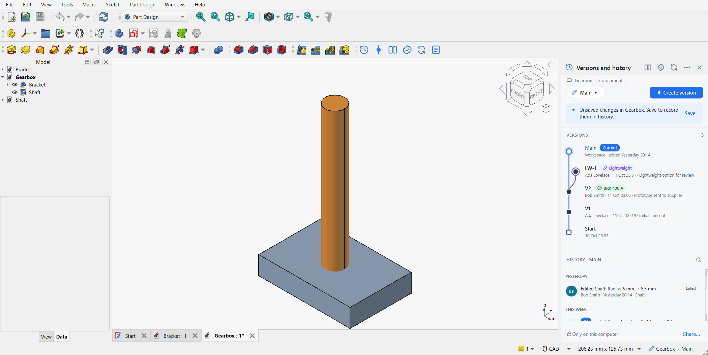

Strata is a free, open-source add-on for FreeCAD that adds the product data management engineers expect from modern CAD. It implements the proposal discussed in the FreeCAD forum thread [*Proposal for Integrated Version Control in FreeCAD for PLM/PDM Functionality*](https://forum.freecad.org/viewtopic.php?t=89249). Git stores everything underneath, but the interface only speaks in engineering terms: versions, workspaces, restore, compare and release.

## Keyboard shortcuts

| Keys | Command |
|---|---|
| <kbd>Ctrl</kbd>+<kbd>Shift</kbd>+<kbd>H</kbd> | Versions and history panel |
| <kbd>Ctrl</kbd>+<kbd>Shift</kbd>+<kbd>V</kbd> | Create version |
| <kbd>Ctrl</kbd>+<kbd>Shift</kbd>+<kbd>D</kbd> | Compare |
| <kbd>Ctrl</kbd>+<kbd>Shift</kbd>+<kbd>R</kbd> | Releases |
| <kbd>Ctrl</kbd>+<kbd>Shift</kbd>+<kbd>Y</kbd> | Sync |

The same commands are at the bottom of the **Tools** menu. More in the [shortcuts reference](https://foadsf.github.io/freecad-strata/strata/shortcuts.html).

## Contents

- [Features](#features)
- [Installation](#installation)
- [Quick start](#quick-start)
- [How it works](#how-it-works)
- [Tour](#tour)
- [FAQ](#faq)
- [Development and tests](#development-and-tests)
- [Roadmap](#roadmap)
- [Contributing](#contributing) · [License](#license)

## Features

| | |
|---|---|
| **Automatic history** | Every save is recorded and described in plain language, e.g. *Edited Base plate: Length 10 mm → 12 mm* or *Added Bore*. Nobody types commit messages. |
| **Versions** | Named, permanent snapshots of the whole project (*V2 – Prototype sent to supplier*). |
| **Workspaces** | Separate lines of work for design alternatives. Main stays untouched until you merge. |
| **Go back in time** | Open any version or history entry as a read-only copy, or **Restore** it. A restore adds a new history entry, so nothing is ever lost. |
| **Compare** | Added, deleted and edited features with old → new values, plus a **3D before/after overlay** with the volume change. |
| **Merge** | Onshape's merge strategies (*Merge changes*, *Keep target*, *Replace with source*) with a choice per document, *Compare with base*, and *Undo merge*. A properties-only edit on one side combines with a model edit on the other automatically. |
| **Properties** | Part numbers, descriptions and custom properties for every document in one table, versioned with the design and used by releases. |
| **Releases** | Part number plus revision (letters per ASME Y14.35, or numbers), optional approval, reject with a reason and resubmit, revision history per part number, *Obsolete* (optionally re-releasable), export of a released revision to FCStd + STEP. |
| **Team sync** | Share through a network folder, a synced drive (OneDrive, Nextcloud, Dropbox) or any Git server. Works offline; sync when you're back. |
| **Assemblies** | All documents in a project folder are versioned together, so links between assemblies and parts always match. |
| **Everywhere** | One panel and toolbar available in every workbench, a workspace indicator in the status bar, light and dark themes. |

## Installation

### Requirements

- **FreeCAD 1.0 or newer.** Developed and fully tested on FreeCAD 1.1.4 on Windows 11. On Linux the engine's test suite passes in CI on every change; the FreeCAD interface has not been tested there yet, and macOS not at all. Reports are welcome.
- **Git** installed, any recent version: [git-scm.com](https://git-scm.com/downloads). On Linux use your package manager (`sudo apt install git`); on macOS run `xcode-select --install`. Strata finds Git on the `PATH` and in the default Git for Windows and GitHub Desktop locations. Engineers never use Git directly.

### Option A: FreeCAD Addon Manager (recommended)

Until Strata is listed in the official add-on index, add it as a custom repository:

1. In FreeCAD open **Edit → Preferences → Addon Manager**.
2. Under **Custom repositories** click **+** and enter
   - Repository URL: `https://github.com/Foadsf/freecad-strata`
   - Branch: `main`
3. Click **OK**, open **Tools → Addon manager**, search for **strata** (custom repositories are listed under their repository name, *freecad-strata*), click **Install** and restart FreeCAD.

The Addon Manager installs it into `Mod/freecad-strata`. Use either the Addon Manager or the manual install below, not both, or Strata would be loaded twice.

### Option B: Manual install

Clone or download this repository into FreeCAD's user `Mod` folder as a folder named `Strata`:

| FreeCAD | Windows | Linux | macOS |
|---|---|---|---|
| 1.1 | `%APPDATA%\FreeCAD\v1-1\Mod\Strata` | `~/.local/share/FreeCAD/v1-1/Mod/Strata` | `~/Library/Application Support/FreeCAD/v1-1/Mod/Strata` |
| 1.0 | `%APPDATA%\FreeCAD\Mod\Strata` | `~/.local/share/FreeCAD/Mod/Strata` | `~/Library/Application Support/FreeCAD/Mod/Strata` |

For example, on Linux with FreeCAD 1.1:

```bash
git clone https://github.com/Foadsf/freecad-strata.git ~/.local/share/FreeCAD/v1-1/Mod/Strata
```

On Windows (PowerShell):

```powershell
git clone https://github.com/Foadsf/freecad-strata.git "$env:APPDATA\FreeCAD\v1-1\Mod\Strata"
```

Restart FreeCAD. The **Versions and history** panel appears on the right, and a **Strata** toolbar (Versions and history, Create version, Compare, Releases, Sync) is available in every workbench. A small *Strata* entry also appears in the workbench selector with the same commands in its menu. If you closed the panel, click the history-clock button in that toolbar or the *project · workspace* indicator in the status bar. To uninstall, delete the `Strata` folder (or use the Addon Manager); your projects' history stays in their `.strata` folders.

## Quick start

1. **Save** your FreeCAD documents into one project folder (sub-folders are fine).
2. In the **Versions and history** panel click **Turn on version control** and confirm the folder and your name.

   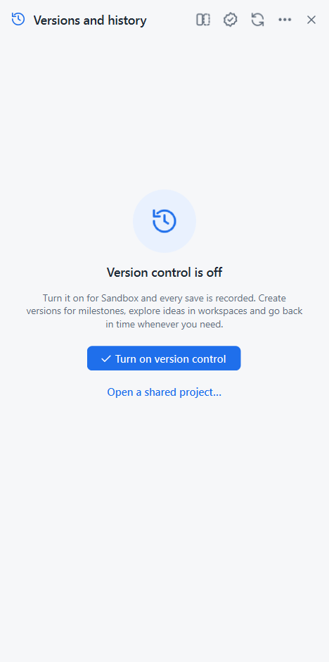 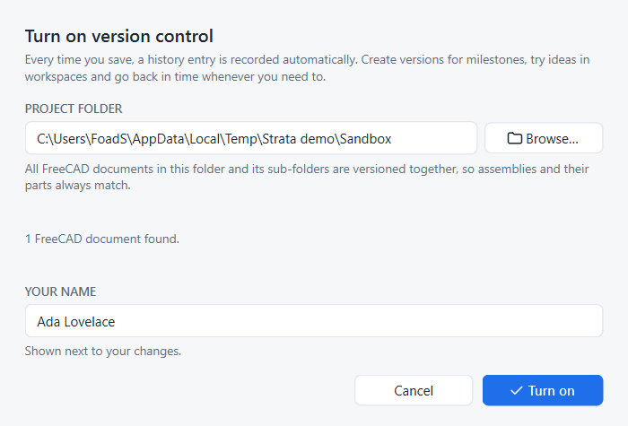

3. **Work and save as usual.** Every save appears in *History*.
4. **Create version** when you reach a milestone.
5. Use the workspace pill (**Main ▾**) to create a workspace for an alternative, switch between workspaces and merge them.
6. Hover a history entry to **view** (eye) or **restore** it. Right-click versions and entries for everything else: compare, branch, release.
7. Click **Share…** in the panel footer to choose a shared location, then **Sync** to exchange work with colleagues. They use **⋯ → Open a shared project…**.

## How it works

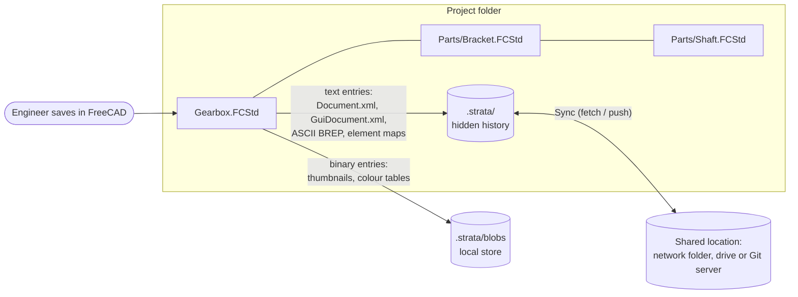

- **A project is a folder.** Strata versions every `.FCStd` in the folder together, so an assembly and the parts it links to are always consistent at every version.
- **The history lives beside the files.** The forum proposal suggested a Git repository *inside* each `.FCStd`. Testing on FreeCAD 1.1.4 showed that FreeCAD rewrites the archive on every save and **drops entries it does not know**, so an embedded repository would be erased by the next save. Strata therefore keeps a hidden repository in `<project>/.strata/`, and your `.FCStd` files stay normal FreeCAD files.
- **Text goes to Git, binaries stay local.** Each saved archive is unpacked into its entries. Textual entries go into history. That includes the BREP geometry, so imported, non-parametric solids such as STEP imports restore exactly, without a recompute. Binary entries (thumbnails, colour tables, binary BREP) go to a local content-addressed store, so restores on your machine are byte-exact. *Project settings* can share binaries too.
- **Semantic, not textual, diffs.** History titles and *Compare* come from a semantic diff of FreeCAD's `Document.xml`. It reports features and parameters with units, and filters FreeCAD's own bookkeeping: origin features, attachment-driven placements, floating-point noise, link timestamps.
- **Engineering words, Git underneath:**

  | You see | Stored as |
  |---|---|
  | History entry | commit |
  | Version | annotated tag `v/<name>` |
  | Workspace | branch |
  | Restore | new commit with an earlier tree |
  | Merge | three-way merge per document |
  | Release / approval / obsolete | tags `release/`, `pending/`, `rejected/`, `obsolete/<part>/<rev>` |
  | Sync | fetch + push of workspaces and tags |

- **Fast.** Objects and references are written and read directly in Python; the `git` program is only started for setup, fetch, push and packed objects. Recording a save takes about 0.1 s.
- **Scriptable.** The engine (`strata/project.py`) has no FreeCAD or Qt dependency, so it can be scripted or wrapped by connectors to other PDM/PLM systems:

  ```python
  from strata.project import Project
  p = Project.locate("C:/cad/Gearbox/Gearbox.FCStd")
  p.create_version("V3", "Released for tooling")
  print([e.title for e in p.history()[:5]])
  ```

### Embedding Strata in another add-on

Add-ons that bring their own interface (e.g. [freecad-nxstyle](https://github.com/Foadsf/freecad-nxstyle), which uses Strata in place of Teamcenter) can host Strata without patching it:

```python
import strata.boot as sb
from strata.ui import theme

sb.configure(host_toolbar=True, panel_area="left",   # from the host's InitGui.py; saved as preferences
             shortcuts={"Strata_Compare": None})     # keys the host needs: None leaves a command unbound
sb.on_ready(lambda: my_ribbon.add_actions(sb.actions().values()))  # QActions created at startup
theme.set_overrides(light={"accent": "#00838F", "accent_hover": "#006D77"})  # restyles open panels
```

- `host_toolbar=True`: Strata adds no toolbar and never re-activates the current workbench, so the host keeps its own toolbars and shortcuts. The host calls `sb.activate_commands()` when Strata's Tools-menu entries and keys should appear.
- `shortcuts={command: keys or None}`: the host chooses Strata's keys (default `Ctrl+Shift+H/V/D/R/Y`); set it before Strata starts.
- `panel_area`: `"left"` or `"right"`. The panel is created there, so nothing is moved after startup.
- `actions()`: `{command name: QAction}`, enabled and disabled with the active project. You don't depend on FreeCAD's lazily created command actions.
- `on_ready(callback)`: runs once Strata is up, or immediately if it already is. No polling needed.
- `theme.set_overrides(light=…, dark=…, lanes_light=…, lanes_dark=…)`: rejects unknown tokens. Token names are in `strata/ui/theme.py`.

`tests/embed_test.py` covers this API in the real GUI.

## Tour

### Versions and history

The version graph shows each workspace in its own lane: versions are solid nodes, workspaces are open nodes, and release badges sit on the versions they belong to. Selecting a history entry shows exactly what changed, with **View**, **Restore** and **Compare** at hand.

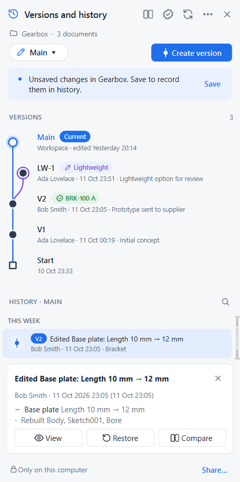 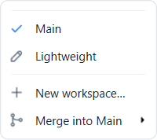 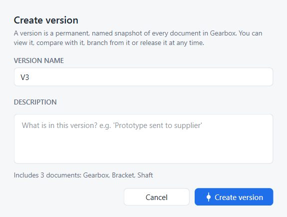

### Workspaces

Explore a lighter design without touching Main. Switching workspaces updates the documents on disk and reloads them in FreeCAD.

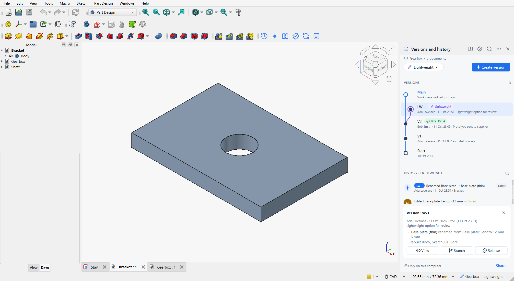

### Go back in time

Open any version or history entry as a read-only copy, linked parts included. A banner reminds you that it isn't part of the project.

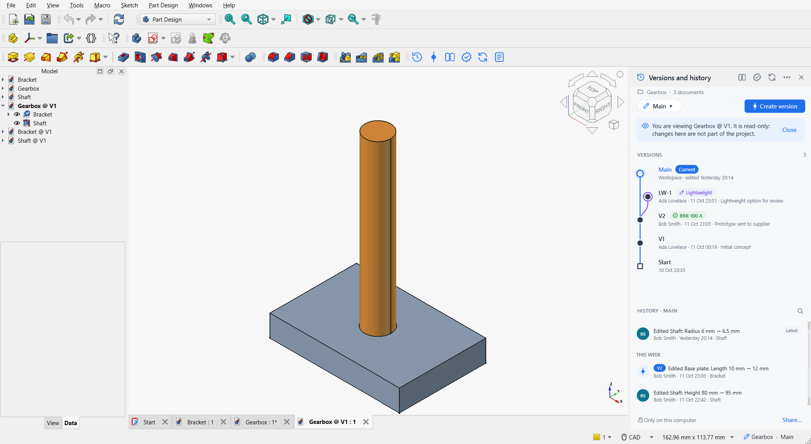

### Compare

See every feature and parameter that changed, then overlay both states in 3D: before in translucent red, after in blue, with the volume change.


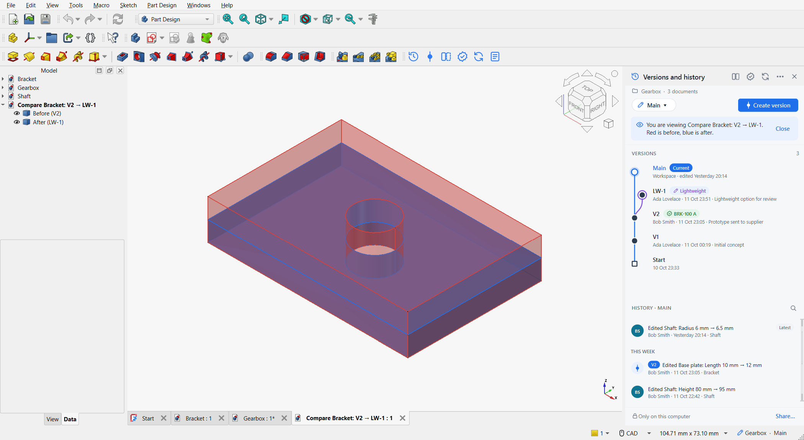

### Merge

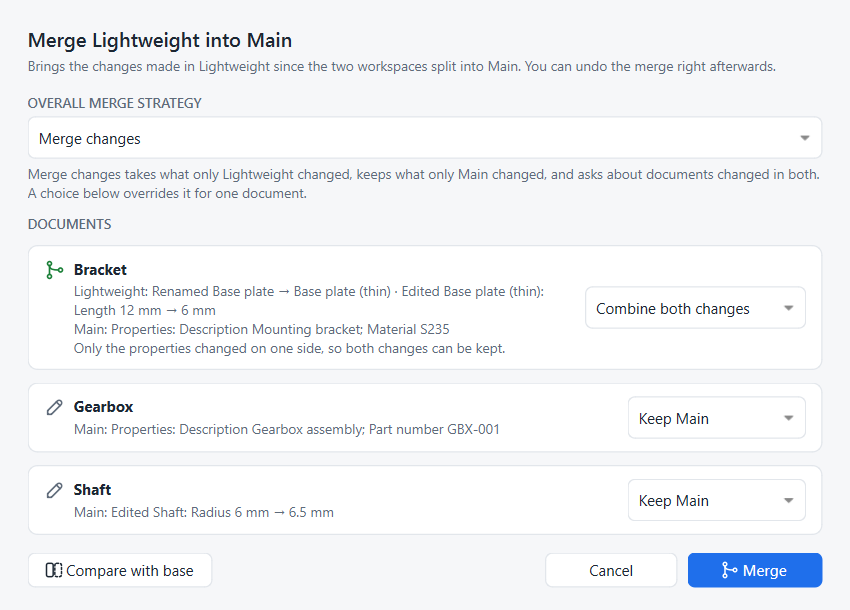

### Releases

Release documents from a version with part number and revision, optionally through an approval step, and track every revision's state.


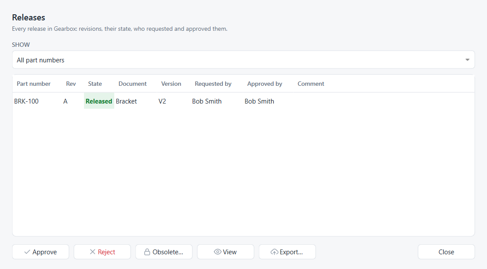

Coming from Onshape? The documentation's [Coming from Onshape](https://foadsf.github.io/freecad-strata/strata/tutorials/coming-from-onshape.html) page maps Onshape's PDM and release tutorials to Strata, step by step.

### Share with your team, and dark theme

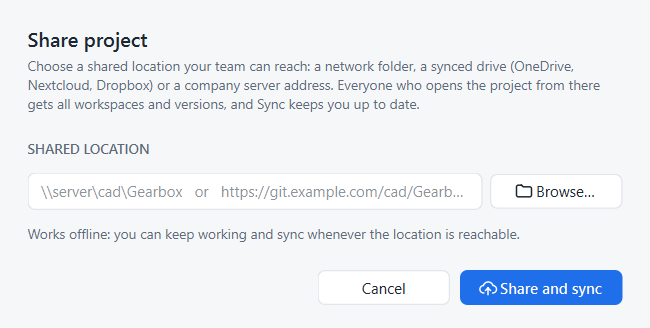 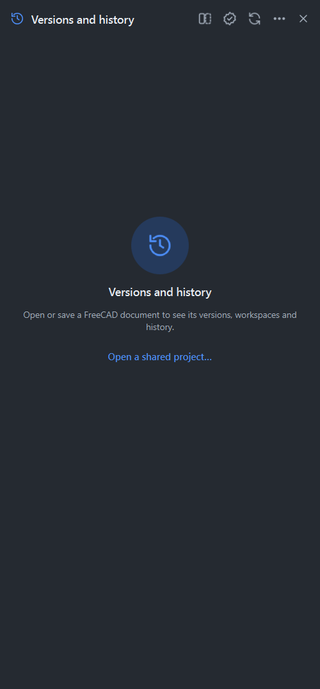

## FAQ

**Do I need to know Git?** No. Strata never shows Git terms or asks for commit messages. If you do know Git, `<project>/.strata/repo.git` is a normal bare repository you can inspect.

**Does it need a server or internet?** No. Everything works offline on one computer. For teams, any shared folder or Git server works as the shared location.

**What if FreeCAD says the assembly has unsaved changes right after opening?** FreeCAD marks an assembly as modified when it refreshes external links on open. Strata shows this honestly and asks to save before switching workspaces. Documents that Strata itself reloads are not flagged.

**Are my files changed?** Your `.FCStd` files stay ordinary FreeCAD files. Strata only rewrites them when you switch workspace, restore, merge or sync, and the previous state always stays in history.

**Uninstalling through the Addon Manager on Windows says "Failed to remove some files".** This is a known Addon Manager behaviour (seen with FreeCAD 1.1.4): its Git update check can leave FreeCAD's working directory inside the add-on folder, and Windows won't delete a folder in use. The files are removed but an empty `Mod/freecad-strata` folder stays behind. Close FreeCAD and delete that folder. Your projects' history is not affected.

**Fonts, macros, external STEP files?** Strata versions FreeCAD documents. Machine-dependent resources such as system fonts are not captured.

## Development and tests

```
InitGui.py            starts Strata in the FreeCAD GUI (global panel, not a workbench)
strata/gitcore.py     dependency-free Git plumbing (loose objects, refs, history walks)
strata/fcstd.py       explode / rebuild .FCStd archives, local binary store
strata/docdiff.py     semantic Document.xml diff and plain-language summaries
strata/project.py     the model: record, versions, workspaces, restore, merge, releases, sync
strata/fc.py          FreeCAD glue: save observer, reload, previews, 3D compare overlay
strata/ui/            design tokens + icons, version graph, history list, panel, dialogs
tests/                core tests, FreeCAD engine test, GUI walkthrough that makes the screenshots
```

Core tests run in plain Python and need only Git:

```bash
python tests/test_core.py
```

The engine test runs inside FreeCAD (console). It checks restored geometry volumes, assembly links, workspace isolation, merge and the 3D overlay:

```bash
freecadcmd tests/fc_engine_test.py
```

The GUI walkthrough builds a demo project, drives the panel and every dialog, switches workspaces and saves the screenshots in this README. It uses a throwaway FreeCAD preferences file:

```bash
python tests/run_gui_hidden.py <work-folder> <screenshot-folder>
```

The Addon Manager test installs Strata from this GitHub repository through the real Addon Manager window: it types in the search box, clicks the entry and the Install button. It then restarts FreeCAD to check that Strata starts by itself and records a save, and finally uninstalls through the Uninstall button. Run it with a throwaway `--user-cfg`; see the docstring in `tests/am_install_test.py`.

## Roadmap

- Merge inside a single document (feature-level) instead of per document.
- File locking / check-out for teams that want it.
- Release packages: automatic STEP/PDF export when a revision is released (manual export exists since 0.3.0).
- Roles and approvers, BOM view, where-used.
- Connectors to commercial PDM/PLM systems through the engine API.
- Submission to the official FreeCAD add-on index.

## Contributing

Issues and pull requests are welcome. Please run the core tests and, for anything that touches FreeCAD, the engine test before opening a pull request. Discussion happens in the [FreeCAD forum thread](https://forum.freecad.org/viewtopic.php?t=89249) and in this repository's issues.

## License

Strata is free software, licensed under the [GNU Lesser General Public License v2.1 or later](LICENSE), the same license as FreeCAD.
